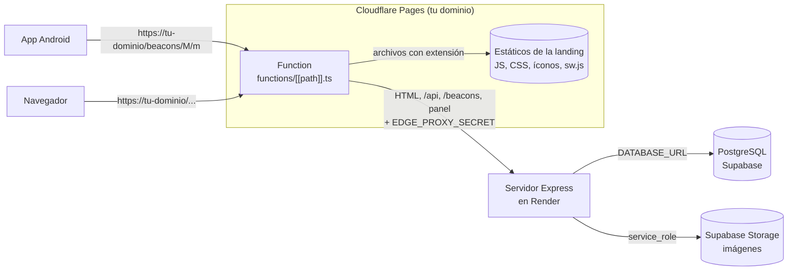

# Desplegar SIGNAL en Cloudflare Pages, Render y Supabase

Esta guía publica SIGNAL en producción con tres servicios. **Producción se despliega siempre desde `main`**: el trabajo se hace en `develop` y llega a `main` por pull request. Cada merge a `main` publica el sitio solo.

> **Nunca compartas las credenciales.** Ni la contraseña de Supabase, ni la clave `service_role`, ni los secretos de abajo van en chats, issues, commits o capturas. Solo viven en el panel de Render y en el de Cloudflare.

## 0. Cómo se conectan las piezas



- **Cloudflare Pages** es la puerta de entrada: tiene el dominio y el HTTPS, y sirve desde su CDN los archivos de la landing. Todo lo demás lo reenvía al servidor con una Function (`functions/[[path]].ts`, lógica en `apps/edge/`).
- **Render** corre el servidor Express de siempre: arma el HTML con los datos y el tema, atiende la API, el panel en `/<ADMIN_PATH>` y la app Android. Pages no puede correrlo: el servidor usa librerías nativas (`sharp`, `argon2`), disco para respaldos y límites de intentos en memoria.
- **Supabase** guarda la base de datos y las imágenes. **Solo el servidor se conecta a Supabase.** Cloudflare, el navegador y la app nunca la tocan, así que no hay que configurar nada de Supabase en Cloudflare.

Por qué funciona sin cambiar el frontend: para el navegador todo sale de **un solo dominio**. Las cookies `__Host-` del panel, el CSRF y la CSP siguen igual que en local.

**El secreto compartido (`EDGE_PROXY_SECRET`).** La Function lo envía en cada petición y el servidor rechaza con 404 lo que llegue sin él. Así nadie puede saltarse Cloudflare entrando directo a `signal-api.onrender.com`, ni inventar su IP para esquivar los límites de intentos. La única excepción es `/api/health`, que Render usa para saber si el servidor está vivo.

## 1. Lo que vas a necesitar

| Qué                          | Para qué                                     | Costo aproximado                                                     |
| ---------------------------- | -------------------------------------------- | -------------------------------------------------------------------- |
| Proyecto de Supabase         | Base de datos e imágenes                     | Gratis (se pausa tras una semana sin uso) o Pro                       |
| Cuenta de Render             | Servidor Express (plan **Free**)             | Gratis: 750 horas al mes por espacio de trabajo                        |
| Cuenta de Cloudflare         | Pages, dominio y HTTPS                       | Gratis hasta 100.000 peticiones al día a la Function                  |
| Un dominio (recomendado)     | La dirección pública y la de la app Android  | Según el registrador; puede estar en Cloudflare                       |
| El repositorio en GitHub     | Render y Cloudflare despliegan desde `main`  | —                                                                    |

**Límites del plan gratis de Render:**

- **Se suspende** tras 15 minutos sin peticiones y tarda cerca de un minuto en despertar. Mientras despierta, la primera consulta de la app Android o de la página espera. El paso 4.1 explica cómo mantenerlo despierto.
- **750 horas al mes por espacio de trabajo**, compartidas entre todos sus servicios gratuitos. Un servicio despierto todo el mes gasta unas 744: si mantienes este despierto, no queda cupo para otro servicio gratuito en el mismo espacio de trabajo.
- **Sin disco persistente:** los respaldos automáticos están desactivados (`BACKUP_INTERVAL_HOURS=0`). Respalda desde tu computador con `npm run backup` usando el `.env` de Supabase. El snapshot de beacons para cuando Supabase no responde se regenera cada vez que el servidor arranca.
- **512 MB de memoria y CPU compartida:** alcanza para SIGNAL, pero subir imágenes grandes es más lento.

Si más adelante la app necesita respuesta inmediata siempre, cambia `plan: free` por `plan: starter` en `render.yaml` (unos 7 USD al mes, pide tarjeta).

Cada visita a una página pasa por la Function varias veces (el HTML y algunos archivos). Con el plan gratuito de Cloudflare caben del orden de 5.000 a 10.000 páginas vistas al día, más las consultas de la app. Si se acerca al límite, el plan Workers Paid (5 USD/mes) lo sube a 10 millones al mes.

## 2. Preparar Supabase

Sigue [`docs/supabase.md`](supabase.md), pasos 1 a 3 y 7.1–7.2. Al terminar tendrás:

- `DATABASE_URL`: el **Transaction pooler** (puerto `6543`) con `?pgbouncer=true` al final.
- `DIRECT_URL`: el **Session pooler** (puerto `5432`).
- `SUPABASE_URL` (`https://<ref>.supabase.co`) y la secret key (`sb_secret_…`) o la `service_role` heredada.
- El bucket **público** `media` creado en Storage.

Usa siempre las URL de los **poolers**, no la «Direct connection»: Render no tiene IPv6 y la conexión directa solo funciona por IPv6.

### 2.1 Crear las tablas y cargar los datos iniciales (una sola vez)

Hazlo desde tu computador, con un `server/.env` que apunte a Supabase ([`docs/supabase.md`](supabase.md), pasos 4 a 6):

```bash
npm run db:deploy        # crea las tablas
npm run import:beacons   # beacons históricos
npm run seed             # cuentas del panel (con SEED_* reales y contraseñas temporales), identidad visual y secciones
```

Después de esto, Render aplica solo las migraciones nuevas al final de cada build. `import:beacons` y `seed` no vuelven a hacer falta.

## 3. Generar los secretos de producción

En tu computador:

```bash
npm run secret
```

De lo que imprime, para producción usa **solo** `ADMIN_PATH` y `EDGE_PROXY_SECRET` (Render genera solo `JWT_SECRET` y `CSRF_SECRET`). Guárdalos en tu gestor de contraseñas. **Nunca reutilices los de desarrollo.**

- `ADMIN_PATH` va solo en Render.
- `EDGE_PROXY_SECRET` va **con el mismo valor** en Render y en Cloudflare.

## 4. Crear el servidor en Render

El archivo [`render.yaml`](../render.yaml) del repositorio ya trae toda la configuración (plan gratis, región, comandos y variables fijas). Al no tener recursos de pago, no debería pedir tarjeta.

1. En [dashboard.render.com](https://dashboard.render.com), pulsa **New → Blueprint**.
2. Conecta GitHub si te lo pide y elige el repositorio `Sistema-Beacons`. Branch: **`main`**.
3. Render lee `render.yaml` y pide las variables marcadas con `sync: false`:

   | Variable                    | Valor                                                                                   |
   | --------------------------- | --------------------------------------------------------------------------------------- |
   | `ADMIN_PATH`                | El del paso 3.                                                                          |
   | `EDGE_PROXY_SECRET`         | El del paso 3.                                                                          |
   | `SITE_URL`                  | Tu dominio con `https://` y sin `/` final, por ejemplo `https://signal.cl`. Si aún no tienes dominio, la URL de Pages del paso 5 (`https://<proyecto>.pages.dev`). |
   | `DATABASE_URL`              | Transaction pooler, puerto 6543, con `?pgbouncer=true`. Sin comillas.                   |
   | `DIRECT_URL`                | Session pooler, puerto 5432. Sin comillas.                                              |
   | `SUPABASE_URL`              | `https://<ref>.supabase.co`                                                             |
   | `SUPABASE_SERVICE_ROLE_KEY` | La secret key (`sb_secret_…`) o la `service_role` heredada.                             |

4. Pulsa **Apply**. Render compila (`npm ci --include=dev && npm run build`), aplica las migraciones (`npm run db:deploy`) y arranca (`npm start`). Si las migraciones fallan, el despliegue se cancela y sigue la versión anterior.
5. Cuando diga **Live**, copia la URL del servicio, por ejemplo `https://signal-api.onrender.com`. Es el `BACKEND_ORIGIN` del paso 5.
6. Comprueba que responde y que está cerrado al público:

   ```bash
   curl https://signal-api.onrender.com/api/health
   # {"ok":true,"db":"ok"}
   curl https://signal-api.onrender.com/beacons/1/1
   # {"error":"No encontrado","code":"NOT_FOUND"}   ← correcto: sin pasar por Cloudflare no responde
   ```

`autoDeployTrigger: checksPass` hace que Render despliegue cada commit de `main` **solo si el CI de GitHub pasó**.

### 4.1 Mantenerlo despierto (recomendado)

Para que la app no espere un minuto cuando el servidor estuvo suspendido, un monitor gratuito lo consulta cada 5 minutos:

1. Crea una cuenta en [UptimeRobot](https://uptimerobot.com) (o un servicio parecido).
2. **New monitor → HTTP(s)**, con la URL `https://signal-api.onrender.com/api/health/live` (la de tu servicio) y un intervalo de **5 minutos**.
3. De paso, te avisa por correo si el servidor se cae.

Usa `/api/health/live` y no otra ruta: es la única que responde sin pasar por Cloudflare y no consulta la base. Mantenerlo despierto es una práctica común, pero Render no la garantiza en el plan gratis. Si la app necesita una respuesta inmediata garantizada, usa el plan Starter.

## 5. Crear el sitio en Cloudflare Pages

1. En [dash.cloudflare.com](https://dash.cloudflare.com), entra a **Workers & Pages** y pulsa **Create application**. Elige la pestaña o el enlace de **Pages** (no Workers) y luego **Connect to Git** (o **Import an existing Git repository**).
2. Autoriza GitHub y elige el repositorio `Sistema-Beacons`.
3. Configura el build:

   | Campo                  | Valor                    |
   | ---------------------- | ------------------------ |
   | Production branch      | `main`                   |
   | Framework preset       | `None`                   |
   | Build command          | `npm run build:pages`    |
   | Build output directory | `apps/web/dist/public`   |
   | Root directory         | (vacío: la raíz)         |

   La versión de Node la toma del archivo `.node-version` (24). No hace falta la variable `NODE_VERSION`.

4. En **Environment variables (advanced)**, agrega, para **Production**:

   | Variable            | Tipo                 | Valor                                                 |
   | ------------------- | -------------------- | ----------------------------------------------------- |
   | `BACKEND_ORIGIN`    | Text                 | La URL de Render del paso 4, sin `/` final.           |
   | `EDGE_PROXY_SECRET` | **Secret** (Encrypt) | El mismo valor que pusiste en Render.                 |

   Si el asistente no muestra esta sección, crea el proyecto y agrégalas después en **Settings → Variables and Secrets**; luego vuelve a desplegar desde **Deployments → … → Retry deployment**.

5. Pulsa **Save and Deploy**. El build compila la landing, verifica que el bundle público no tenga nada del panel y agrega `404.html` y `sin-servidor.html`.
6. **Desactiva las vistas previas:** **Settings → Builds → Branch control → Preview branch: None**. Una vista previa usaría el mismo servidor y la misma base de producción y mostraría el sitio de producción igual, así que no aporta y solo suma riesgo.

### 5.1 Conectar tu dominio

1. En el proyecto de Pages: **Custom domains → Set up a custom domain** y escribe tu dominio (`signal.cl` o `www.signal.cl`).
2. Si el dominio está en Cloudflare, el registro DNS se crea solo. Si no, Cloudflare indica el `CNAME` que debes crear en tu proveedor.
3. Espera a que el estado diga **Active** (el certificado HTTPS se emite solo).
4. Si al crear el servidor usaste la URL `*.pages.dev` como `SITE_URL`, cámbiala ahora en Render (**Environment**) por tu dominio y guarda: Render redespliega solo.

Entra siempre por el dominio de `SITE_URL`. Desde otra dirección (por ejemplo `*.pages.dev` cuando ya tienes dominio) el sitio se ve, pero el servidor rechaza los formularios y el ingreso al panel por venir de otro origen. Si quieres, redirige `*.pages.dev` a tu dominio con **Rules → Redirect Rules** (o **Bulk Redirects**) de Cloudflare.

## 6. Comprobar el despliegue

Con tu dominio (reemplaza `tu-dominio`):

```bash
curl https://tu-dominio/beacons/1/1          # la ficha: { titulo, descripcion, ubicacion }
curl https://tu-dominio/beacons/99/99        # {"error":"No hay información para el beacon 99-99"}
curl -I https://tu-dominio/admin             # 404
curl https://tu-dominio/robots.txt           # Sitemap: https://tu-dominio/sitemap.xml
```

En el navegador:

1. Abre `https://tu-dominio/`: la landing se ve con su contenido. En las herramientas de desarrollo, **Network**, los archivos de `/assets/` salen con `cache-control: public, max-age=31536000, immutable`.
2. Abre `https://tu-dominio/<ADMIN_PATH>`, entra con cada cuenta del seed y crea la contraseña definitiva. Luego puedes borrar las variables `SEED_*` de tu `server/.env`.
3. Sube una imagen en el panel y comprueba que aparece en **Supabase → Storage → media** y en el sitio.
4. Instala la PWA desde el navegador del teléfono y prueba sin conexión una página que ya visitaste.

## 7. Conectar la app Android

1. En `BeaconsAndroid/app/src/main/java/com/example/proyectobeacons/data/RetrofitClient.kt`, cambia `BASE_URL` a `https://tu-dominio/` (con `/` final).
2. Con HTTPS ya no hace falta la excepción de `network_security_config.xml` para producción.
3. Recompila e instala la app. El contrato `GET /beacons/:major/:minor` no cambia.

## 8. Publicar cambios

1. Trabaja en `develop` y abre un pull request a `main`.
2. Cuando el CI pase y se haga el merge:
   - **Cloudflare Pages** compila y publica la landing.
   - **Render** espera al CI de `main`, compila, aplica las migraciones nuevas y cambia a la versión nueva cuando esta ya responde, sin cortar el servicio. Las migraciones se aplican antes del cambio, mientras la versión anterior sigue atendiendo: una migración que borre o renombre columnas debe hacerse en dos despliegues (primero el código que ya no las usa, después la migración).
3. Los dos despliegues terminan en momentos distintos. Mientras tanto no se rompe nada: si el HTML del servidor pide un archivo que Pages todavía no tiene (o ya no tiene), la Function se lo pide al servidor, que tiene los de su propio build.

Para volver atrás: en Pages, **Deployments → la versión anterior → Rollback**; en Render, **Events → el deploy anterior → Rollback**. Las migraciones de base de datos no se deshacen solas.

## 9. Probar la Function en tu computador (opcional)

Con el servidor local encendido (`npm run dev`) y un `EDGE_PROXY_SECRET` en `server/.env`:

```bash
npm run build:pages
npx wrangler@4 pages dev apps/web/dist/public --port 8788 \
  --binding BACKEND_ORIGIN=http://localhost:3000 \
  --binding EDGE_PROXY_SECRET=<el-mismo-de-server/.env>
```

Abre `http://localhost:8788`. Para no escribir el secreto en la terminal, ponlo en un archivo `.dev.vars` en la raíz (`EDGE_PROXY_SECRET=...`); git lo ignora. Agrega `SITE_URL=http://localhost:8788` en `server/.env` si vas a entrar al panel por ese puerto.

## Problemas frecuentes

| Síntoma                                                                         | Causa probable                                                                 | Qué hacer                                                                                                     |
| ------------------------------------------------------------------------------- | ------------------------------------------------------------------------------ | ------------------------------------------------------------------------------------------------------------- |
| Todo el sitio responde `{"error":"No encontrado","code":"NOT_FOUND"}`           | `EDGE_PROXY_SECRET` distinto en Render y en Cloudflare.                        | Copia el mismo valor en los dos y vuelve a desplegar Pages (**Retry deployment**).                             |
| Responde `EDGE_MISCONFIGURED` (500)                                             | Falta `BACKEND_ORIGIN` o `EDGE_PROXY_SECRET` en Pages, o tienen mal formato.   | **Settings → Variables and Secrets** (en Production). El detalle está en **Functions → Real-time logs**.       |
| Página «SIGNAL no responde en este momento» o `UPSTREAM_UNAVAILABLE` (502)      | Render está caído, desplegando con error o `BACKEND_ORIGIN` apunta mal.         | Revisa **Logs** y **Events** en Render. Comprueba `curl <BACKEND_ORIGIN>/api/health/live`.                     |
| El build de Render falla en `prisma generate` o `vite`                          | Se cambió el build command y faltan las devDependencies.                       | Debe ser `npm ci --include=dev && npm run build && npm run db:deploy`.                                                              |
| El build de Render falla en `db:deploy` con `P1001` o se queda colgado          | `DIRECT_URL` falta, usa la «Direct connection» o el puerto 6543.               | Usa el Session pooler, puerto 5432 ([`docs/supabase.md`](supabase.md), paso 3).                                 |
| El servidor no arranca: `Configuración inválida en server/.env`                 | Falta o sobra una variable en Render.                                          | La lista dice cuál. Las variables están en **Environment** del servicio.                                       |
| El ingreso al panel responde `ORIGIN_NOT_ALLOWED`                               | Entraste por una dirección distinta de `SITE_URL`.                             | Entra por el dominio de `SITE_URL`, o corrige `SITE_URL` en Render.                                            |
| La primera petición tarda cerca de un minuto                                    | El servidor gratis estaba suspendido.                                          | Configura el monitor del paso 4.1.                                                                             |
| `/api/health` dice `"db":"sin conexión"`                                        | Supabase pausado (plan gratuito) o credenciales cambiadas.                     | Reanuda el proyecto en Supabase o actualiza `DATABASE_URL`. La app sigue respondiendo desde el snapshot.        |
| Cloudflare avisa que te acercas al límite diario de la Function                 | Mucho tráfico en el plan gratuito.                                             | Pasa la cuenta a Workers Paid.                                                                                 |

## Resumen de variables

**Render** (además de las fijas de `render.yaml`):

| Variable                                   | De dónde sale                                     |
| ------------------------------------------ | ------------------------------------------------- |
| `ADMIN_PATH`, `EDGE_PROXY_SECRET`          | `npm run secret`                                  |
| `JWT_SECRET`, `CSRF_SECRET`                | Render las genera (`generateValue`)               |
| `SITE_URL`                                 | Tu dominio con `https://`                         |
| `DATABASE_URL`, `DIRECT_URL`               | Supabase → Connect (poolers)                      |
| `SUPABASE_URL`, `SUPABASE_SERVICE_ROLE_KEY` | Supabase → Project Settings → Data API / API Keys |

**Cloudflare Pages** (Production):

| Variable            | Valor                                     |
| ------------------- | ----------------------------------------- |
| `BACKEND_ORIGIN`    | URL del servicio de Render                |
| `EDGE_PROXY_SECRET` | El mismo de Render, como **Secret**       |

**Si un secreto se filtra:** genera uno nuevo con `npm run secret`. Para `EDGE_PROXY_SECRET`, cámbialo primero en Cloudflare y de inmediato en Render (entre ambos cambios el sitio responde 404). Para `JWT_SECRET` o `CSRF_SECRET`, cámbialos en Render: se cierran todas las sesiones del panel. Las credenciales de Supabase se rotan como indica [`docs/supabase.md`](supabase.md#si-una-credencial-se-filtra).
